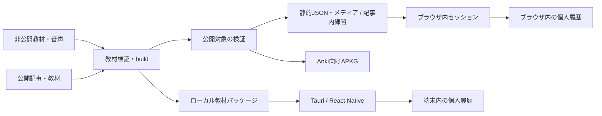

# 教材・音声練習・公開ウィジェットの設計

更新日：2026-10-15。教材manifest v1、CLIによるローカル検証、専用モデル・音声を含むAPKG生成は実装済み。[教材の契約](../reference/content-package.md)と[Anki配布仕様](../reference/content-apkg.md)を参照。アプリの音声セッション、Webウィジェット、Web向け配布パイプラインは未実装。

## 二つの用途

| 用途                                 | 教材の置き場所                           | 学習する場所                             | 必要な体験                                                                 |
| ------------------------------------ | ---------------------------------------- | ---------------------------------------- | -------------------------------------------------------------------------- |
| 自分用の音声付き語学練習             | アプリとは別のprivate repoとローカル音声 | デスクトップ・モバイル、必要に応じてAnki | 音声を聞く、声に出して応答する、繰り返す、解説を見る、記録する             |
| 公開する技術記事・アルゴリズムの練習 | 記事や教材の公開repo                     | 記事内、独自アプリ、Anki                 | 短い一問一答やコードの追跡、答え合わせ、解説へのリンク、Anki用ダウンロード |

個人用教材の本文・音声・具体的な出典やローカル設定はアプリrepoに置かない。公開用のfixtureは自作の短い例にする。公開教材もアプリのソースとは独立して管理できる。

記事を読んだ後に数問を試し、継続したければアプリやAnkiに持ち出せることを目指す。公開ウィジェットはログイン、Anki、Ankinikiのインストールを要求しない。

## 教材、練習、履歴を分ける

教材のソースを一つにし、Web用データ、アプリ用教材、Anki向け配布物を生成する。Ankiのノート形式そのものを、音声練習を含む全UIの内部モデルにはしない。

build入力は指定した教材とその依存だけに限定する。private/publicの全repoをまとめて走査する前提にはしない。個人用APKGのローカル生成も可能だが、公開出力先には流さない。

| 層             | 主な内容                                             | 版・識別の役割                                         |
| -------------- | ---------------------------------------------------- | ------------------------------------------------------ |
| 教材パッケージ | タイトル、項目、解説、記事参照、公開区分、配布情報   | `formatVersion`、安定した`packageId`、教材の`revision` |
| 学習項目       | 問い・答え、コード、音声参照、練習方法               | 本文から独立した`itemId`。内容変更だけで別項目にしない |
| 練習方法       | 表示、音声再生、応答待ち、答え合わせ                 | 一つの項目から作る複数の出題に安定した`activityId`     |
| メディア       | 論理ID、相対パス、形式、ハッシュ、必要なら再生区間   | ローカルの絶対パスを配布物のidentityにしない           |
| 個人履歴       | 回答・自己評価・時刻・所要時間・利用した教材revision | 教材から別保存。公開用buildに入力しない                |

最小のv1は通常の問い・答えと音声応答の定義を扱い、上記の概念のうちプレーンテキスト、安定したID、公開区分、音声の相対パス・ハッシュを検証する。再生区間などの拡張は後続の形式で定義する。形式の版と教材の改訂を分け、未対応の練習方法を黙って通常カードに変えない。後の独自コレクションではこのidentityに保存・予定を関連付ける。

## 音声練習を最初から扱う

初期セッションは「開始 → 問題音声 → 応答待ち → 必要なら模範音声・解説 → 自己評価 → 次の項目」。応答待ちの長さ、再生速度、繰り返し、途中停止、同じ項目の再試行を選べるようにする。文字を先に見せない練習も含める。

音声は教材のassetとして管理し、アプリではローカル取得を優先する。まず短い独立ファイルで検証し、長い音源の区間指定は再生位置・停止精度を端末ごとに確認してから導入する。OSのバックグラウンド移行や着信などで中断された場合は、勝手に完了や回答として記録しない。

再生は利用者の開始操作から行う。ブラウザでは音声の自動再生が制限されるため、再生失敗時にも再開できる操作を用意する（[MDNのautoplay解説](https://developer.mozilla.org/en-US/docs/Web/Media/Guides/Autoplay)）。音声の欠落・未対応形式は開始前に示す。

録音、発音の自動採点、AI判定は初期の必須要件にしない。まず音声を使って反復でき、自己評価と練習記録を残せることを確認する。音声・文面の配布可否は教材ごとに管理する。

## 記事内で完結する練習

公開用の最初の画面は、問い、回答を開く操作、自己評価、次へ、解説へのリンク、Ankiダウンロード。短いセッションを繰り返せるようにする。解答は静的ファイルにも含まれるので、試験用の秘匿や成績認証は目的にしない。

同じ項目を通常の一問一答だけでなく、計算量の説明、コードの結果予測、アルゴリズムの状態を追う問いとして使える。既存の可視化との連携は項目の参照先から始め、教材内に実行コードを埋め込む仕組みを先に作らない。

Web用rendererはHozoの共有表示・操作部品を使い、ナビゲーションや保存先はhostから渡す。まずReact/Viteのサイトで直接利用できる小さな部品を作る。Astroなどのサイトにはブラウザでmountするmoduleとして組み込む方法も検証する。Astroは[クライアントscriptからmoduleを読み込める](https://docs.astro.build/en/guides/client-side-scripts/)。これは採用可能な統合方法であり、現時点でブログへの導入が済んだという意味ではない。

記事本文とダウンロードリンクはJavaScriptなしでも読めるようにし、練習部分だけを起動する。複数の練習部品を同じ記事に置いても状態や音声操作が混線しないことを確認する。パッケージにはUIを任意に実行するscriptを含めず、コード例は文字として表示する。Anki由来のHTMLの保存と、Web/Nativeで安全に表示できる範囲は別の契約にする。

初期の履歴は端末・ブラウザ内に限定する。保存は教材identityと利用者のローカルprofileで分ける。ブラウザの保存はoriginごとで、別サイト・別端末・Ankiへ自動同期されない。保存を拒否された場合もセッション自体は動き、保存できないことを示す。持ち出しは明示的な履歴export/importを後から追加する。

これは軽い教材セッションであり、独自コレクション全体の保存やSRSの導入完了を待たない。最初は出題順と今回の自己評価を扱い、期限・間隔の計算は導入しない。

## Anki向け配布と交換は別の入口

一般の読者向けには、Ankiがそのままimportできる **`.apkg`を第一候補** にする。[Ankiのデッキpackage](https://docs.ankiweb.net/manual/exporting)はノート・モデル・カード・音声や画像をまとめて配布できる。Ankiniki用JSONも提供できるが、現行のノート内容JSONはAnki標準の直接import形式ではない。

`content export`は教材を専用のAnkiノート・テンプレート・メディアへ明示的に写像する。通常の問い・答えと短い音声の表裏表示に対応し、応答時間は目安として表示する。自動待機やアプリ独自の音声再生区間がAnkiへそのまま移るとは保証しない。既存`bundle`はFront/Back作成用の簡易APKG生成として別に残す。

教材identityからAnki GUID・モデル・フィールド・テンプレートへの対応は固定する。本文ハッシュや生成時刻から毎回別のノートにしない。Anki 26.9.3の専用コレクションで、再import、本文・音声更新、利用者の編集との競合、学習予定・履歴の維持を[検証した](../developer/content-apkg-verification.md)。[Ankiの更新仕様](https://docs.ankiweb.net/manual/importing/packaged-decks)には変更時刻、モデル構成、import設定などの条件があるため、任意の変更後も同じIDだけで履歴維持を保証しない。

配布物には個人の復習状態・履歴、学習用profile設定、秘密情報、ローカルの絶対パスを入れない。publisher用identityと、個人のコレクションにあるnote/card IDを区別する。公開前に以下を確認する。

- 指定された教材と参照メディアすべてが、公開可能な対象であること。未指定・不明なものは公開生成を失敗させる。
- 全assetが解決でき、ハッシュが一致し、出力の相対パスが対象ディレクトリ内に収まること。
- WebデータとAPKGが同じ教材revisionを示し、出所・配布条件が含まれること。
- 学習記録や録音、private教材への参照が出力に含まれないこと。

教材ソースの配布条件はアプリのMITとは別に明示する。公開生成とローカル生成は別モードにし、公開生成は許可された入力だけを受け取る。

Ankiから取り出す[交換アーカイブ](anki-exchange.md)は元のデータを保持するための形式。教材パッケージは複数の学習先に配るための形式。Ankiの任意モデルから教材への変換には写像が必要であり、未知のフィールドを勝手に教材の問い・答えへ縮約しない。

## Rustと共有UIの役割

Rustは交換の検証・計画、ファイルとassetの処理、将来の独自保存・予定計算を担う候補のままにする。記事内の練習はネイティブRustやExpressを前提にしない。

まず教材契約・fixtureと小さなTypeScriptのセッション状態を共有し、Hozo画面から使う。Webでも必要な純粋な検証・予定計算をRustへ移すときは、同じ実装のWASM公開を検証する。SQLiteやNative FFIをブラウザまで強制しない。復習ルールをRustとTypeScriptで重複実装する移行にはしない。

追加単位は必要になった順に作る。共有plainカードとStorybookは[packages/learning-ui](../../packages/learning-ui/README.md)に実装した。セッション状態が増えた段階で`packages/learning`へ分ける。教材契約の独立package化や記事向けの配布単位もconsumerの要件に合わせて決める。公開教材repoはこれらの利用者とし、アプリrepoの下に全教材を集める必要はない。`packages/learning`などの後続packageはまだ存在しない。

## 次の実装と完了条件

共有カード表示、Storybook、Markdown教材、MDX記事への埋め込みは[具体化した設計](practice-ui-and-authoring.md)に従う。既存v1のplainカード表示は実装済みで、本文形式とauthoringの拡張は後続のfixtureで確定する。

1. **教材契約を小さく確定（完了）**：自作の技術問題3問と合図音付き応答1項目で、identity、revision、asset、出題方法をCLIから検証できる。音声は自作の合図で、模範発音ではない。
2. **限定したAnki配布・取り込みを検証（完了）**：専用モデル・音声付きAPKGの初回import、再import、教材更新、利用者が編集・復習した後の再importをAnki 26.9.3で確認した。任意モデルの交換アーカイブや全復習履歴の復元は引き続き別の課題。
3. **短い公開セッション**：同じソースから記事内で動く3問を作り、実装済みのAPKG配布とつなぐ。静的Web用データとAPKGが同じrevisionを示し、private教材や個人履歴を含まないことを確認する。
4. **個人用の音声練習**：ローカルのprivate教材をTauriで読み、再生・待機・自己評価・停止・再開を確認する。公開buildに混ざらないことも検証する。
5. **共有画面をモバイルで検証**：最小の音声練習をReact Native実機で動かす。Hozoと音声adapterの実装可否を確認してから画面全体を共有する。
6. **独自の継続学習へ**：予定計算、永続的な復習履歴、backupと端末移動を[アーキテクチャの後続段階](local-first-architecture.md)へ接続する。

公開サイトへの組み込みは、ここで検証した部品・教材形式を使い、サイトごとの変更として進める。
