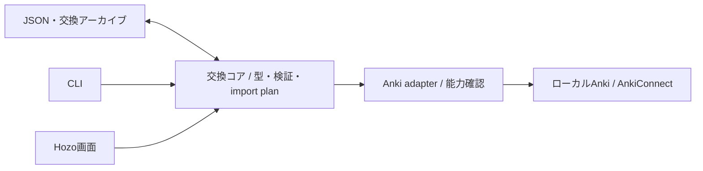

# Ankiniki：互換性から始めるマルチプラットフォーム設計

更新日：2026-10-14。状態：段階的な開発方針。現在の実装と将来の構成を区別する。

## 目標と最初の到達点

最終的にはTauriデスクトップとReact Nativeモバイルで、Hozoの共有画面と共通コアを使い、カードの保存・復習・履歴確認まで完結させる。Ankiとの連携も継続する。自前の常駐Webサーバーは当面の前提にしない。

最初の目標は **Ankiをデータの管理元として維持し、Ankiのデータを互換性を保って取り込み・書き出しできること**。独自DBとスケジューラの導入は後の段階にする。JSONファイルを作れることと、モデル・メディア・復習状態を含めて復元できることを分けて検証する。

互換性の詳細は [Anki交換仕様](anki-exchange.md) に置く。初期設計の独立した学習を最初に作る順序は、この方針に更新する。

## 現状

- `packages/shared`：型、Zod検証、取り込み処理、AnkiConnectクライアント。
- `apps/cli`：Ankiへの通常操作を直接呼ぶ。取り込み・AI生成はExpressを利用する。
- `packages/backend`：AnkiConnectと任意のPythonサービスを仲介するExpress API。
- `apps/desktop`：Tauri。Rust側は設定とメニューを扱い、React画面のデータ操作はExpressを呼ぶ。
- HozoのViteプラグインは導入済み。画面にはDOM要素とWeb用CSSが多く、Nativeとの共有は未完了。
- `ankiniki sync`：AnkiConnectを通してAnkiWeb同期を起動する。独自端末間同期ではない。
- モバイル、共有Rustコア、独自コレクションはまだ存在しない。

## まずAnki交換を独立した機能にする



交換コアはノートのフィールド、モデル、カードの所属、メディア参照を扱う。UIやAnkiの内部APIに依存せず、読み込み・検証・差分の計画を行う。adapterが接続先の能力を報告し、可能な操作だけを実行する。

既存のJSON作成用フォーマットと、Ankiの元データを保つ交換フォーマットを分ける。前者の改行変換やタグ付与を後者に適用しない。元データを勝手に二つのフィールドへ縮約しない。

importは、構造検証、接続先との整合性確認、実行予定の提示、実行結果の確認に分ける。未対応データは黙って落とさず、事前に対象と理由を示す。外部note IDは出所の識別であり、上書きの許可にはしない。

## Rustへの移行

第一候補はRustの共有ライブラリ。CLIは引数・対話・表示を担当し、Tauriはアプリ内のライブラリを呼ぶ。GUIからCLI実行ファイルを毎回起動する構成にはしない。

当面は既存TypeScriptで互換性の不整合を修正し、そのfixtureを共有Rustコアの仕様・テストにも使う。現在のCLIを丸ごと捨てることや全コマンドの移植は、交換コアを作る前提にしない。

```text
crates/ankiniki-core/     交換データ、検証、計画。将来の保存・学習も内部moduleへ
crates/ankiniki-cli/      Rust CLIの入口。既存CLIから段階的に移行
crates/ankiniki-mobile/   Native接続を検証してから導入
packages/app/            Hozoの共有画面・Hooks・画面状態
packages/contracts/      アプリの操作API・共有fixture
apps/desktop/            Tauri command、ウィンドウ、OS機能
apps/mobile/             React Native、ナビゲーション、OS機能
```

これは将来の配置案。最初から全ディレクトリや抽象化を作る必要はない。domainはTauri、CLIの表示、React Native、Anki内部ライブラリに依存させない。

Tauriは標準の [command/invoke](https://v2.tauri.app/develop/calling-rust/) を使う。React NativeへのRust接続は [UniFFI系のbindings](https://github.com/jhugman/uniffi-bindgen-react-native) を候補とし、Android/iOSで実際に検証してから採用する。重ければTypeScript共有コアも選べる。学習ルールを二言語に重複実装して解決しない。

## Hozoで共有する範囲

共有するのは、ノート一覧、編集フォーム、交換プレビュー、カード表示、評価ボタン、統計、テーマと画面の状態。デスクトップのサイドバー・キーボード操作、モバイルのタブ・戻る・Safe Areaは各ホストに置く。

共有画面は `exportNotes`、`previewImport`、`applyImport`、将来の `answerCard` など操作単位のAPIを使う。直接のSQLや接続先のaction名、OSパスを知る必要はない。接続先にない機能は能力情報で表示を切り替える。

Hozo由来の不具合は、バージョンと最小再現を確認して `iray-tno/hozo` の既存Issueを検索し、必要なら起票する。ViteビルドだけでNative対応済みとはしない。ブラウザ用CSS、DOMイベント、任意のHTML表示はNativeでの契約を別途確認する。

## 接続仕様の境界

初期は既存AnkiConnectを利用する。接続先に依存しない操作APIと、AnkiConnect用adapterを分ける。

将来の独自connectorが必要かどうかは、モデル、メディア、カードの所属、履歴・予定の読み書きに不足が確認された段階で決める。新connectorを作る場合は、独立した配布物として版付きのHTTP/JSON APIと能力情報を提供する。公開の交換データを扱い、任意の内部関数呼び出しやDB直接操作をクライアントへ公開しない。

能力情報には、対応する交換形式の版、モデル作成、メディア取得・保存、カードごとの所属、履歴・予定のexport/import、バッチ上限、整合したsnapshotの可否などを含める。snapshotが整合することは、単に複数の読取APIが存在するだけでは保証できない。

## 独自コレクションを持つ段階

交換・復元が信頼でき、共有コアを各アプリから利用できた後に、端末ごとのSQLiteを導入する。Ankiの外部IDと独自UUIDは分離する。

- ノート：元の情報・フィールド・タグ・モデル。
- カード：ノートから生成した出題単位とデッキ所属。
- 現在状態：期限・停止・記憶状態。
- 復習イベント：評価・時刻・所要時間・端末・scheduler/configの版。
- 外部対応表：接続先・外部ID・前回連携した内容。

回答履歴の追加と現在状態の更新は同じトランザクションにする。event IDで再送を重複排除し、状態の版が古ければ再読み込みする。時刻はUTCで保存し、学習日の境界はコレクションのタイムゾーンと設定で計算する。

復習計算は [fsrs-rs](https://github.com/open-spaced-repetition/fsrs-rs) を候補にする。出題順、同日学習、新規上限、兄弟カードの扱いは別の責務。Ankiと同じアルゴリズムを使うことだけでは、予定・履歴の完全互換を保証しない。

## 三種類の同期

1. AnkinikiとAnkiの内容の受け渡し。
2. 既存 `sync` によるAnkiWeb同期の起動。
3. 将来の独自コレクションの端末間同期。

この三つは名前、データ、失敗時の扱いを分ける。現行 `sync` の意味を黙って変更しない。同じカードをAnkiと独自アプリの両方で復習する場合、履歴と予定は自動では統合されない。初期はデッキごとに学習状態の所有者を決める。

独自保存を導入した直後は整合したbackup/exportと明示的な端末引き継ぎを用意する。動作中のSQLiteを共有フォルダで直接同期しない。その後LANや選んだ保存先を使う差分交換を追加する。本文の競合、時計のずれ、同時復習の再計算方針は同期実装時に定義する。

## Webの可能性を残す

共有画面と操作APIを保ち、将来はHTTP adapterと認証を追加できるようにする。サーバー側がRustコアを使うなら、ブラウザへネイティブ保存まで移植する必要はない。ブラウザ内オフライン完結を求める場合は、純粋な計算のWASM化と保存adapterを別に検証する。

現在はアカウント管理、Webサーバー、マルチテナントを実装しない。

## 開発順序と完了条件

1. **環境と現状を整理する**：miseで再現可能なsetup、ビルド、型検査、テスト。資料は実装済みと予定を区別する。
2. **既存CLIのJSON往復を直す**：任意フィールド、HTML、空値、改行、タグ、モデル名をfixtureで確認。既存データへの誤上書きを防ぐ。
3. **交換アーカイブを定義する**：モデル、メディア、カード所属、出所、版、未対応項目。接続先の能力ごとに復元範囲を明示する。
4. **Rustと共有画面を検証する**：同じ交換fixtureをRustで読み、CLI/Tauri/React Nativeから最小操作を呼ぶ。Nativeは実機で確認する。
5. **普段使うデスクトップ・モバイルにする**：交換プレビュー、編集、Anki連携を共有画面へ移す。
6. **独自保存・学習を導入する**：Ankiなしの復習と履歴、backup、端末移動。その後差分同期。

最初の実用的な成功条件は、**Ankiから書き出したノート内容をプレビューし、対応するモデルのAnkiへ内容を変えず取り込めること**。これは元のnote ID、モデル定義、メディア実体、カード別所属、復習履歴を復元したという意味ではない。
