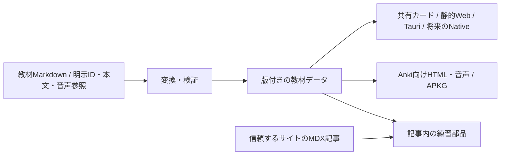

# 共有カード表示・Markdown教材・記事への埋め込み

更新日：2026-10-15。実装前の設計。まず既存教材v1で共有カード表示とStorybookを作り、Markdown authoring、静的セッション、MDX埋め込みへ進む。本文の拡張形式やMarkdownの構文は、後続のfixtureと小さな試作で確定する。

この文書は[教材・学習体験の設計](content-and-learning.md)の次の実装を具体化する。[Anki交換](anki-exchange.md)のデータ保持の契約は変えない。

## 現在地と最初の体験

実装済みなのは[教材v1の検証](../reference/content-package.md)と[専用モデル・音声付きAPKG生成](../reference/content-apkg.md)。v1の`prompt`、`answer`、`explanation`はプレーンテキストで、APKG生成でも文字列をエスケープしている。既存のMarkdown import・`bundle`は簡易カード作成の入口であり、安定した教材identityや音声活動を定義するauthoring形式ではない。

現在の[StudyView](../../apps/desktop/src/renderer/components/StudyView.tsx)は表示とbackend接続を同じcomponentに持ち、Ankiの先頭2フィールドを表裏と見なす。任意モデルのテンプレートや、`ContentId / Front / Back`の専用モデルを正しく表示する仕組みにはなっていない。共有カード表示を追加するだけで、この既存画面の互換性が解決したとは扱わない。

最初に作る体験は、自作教材を「問う → 答えと解説を見る → 自己評価 → 次へ」と試し、同じ教材をAPKGにも配れること。音声練習の表示例も用意する。全画面の移行、独立したコレクション・SRS、Rustへの全面移行はこの体験の前提にしない。

## 先に揃える契約

| 分野     | 方針                                                   | 受入例                                              |
| -------- | ------------------------------------------------------ | --------------------------------------------------- |
| identity | 明示的なpackage/item/activity IDとrevisionを使う       | 文面・順番を変えても同じ項目として更新できる        |
| 本文     | plainとMarkdownを明示し、code・改行・空白を保持する    | v1の`**文字**`は引き続きそのまま表示する            |
| 出題     | 問題・答え・解説と、答えを開く状態を分ける             | 問題を替えたら前の答えが表示されたままにならない    |
| 音声     | 読込・再生・応答待ち・停止・再試行・失敗を区別する     | 再生要求の成功だけで応答待ちや回答済みに進めない    |
| 自己評価 | セッション内の自己評価として記録する                   | 「思い出せた」を客観的な正答率と表示しない          |
| host     | asset解決、外部リンク、保存をhostから渡す              | 表示componentがbackend URLやTauri APIを直接持たない |
| 出力     | Web・Native・Ankiの対応範囲を明示する                  | 未対応の内容を黙って落とさず、診断を返す            |
| 配布     | 教材とassetの公開区分・配布条件・出所を引き継ぐ        | 明示したpublic教材だけで配布物を生成できる          |
| 操作     | 狭い画面、長文、keyboard、読み上げ、文字拡大に対応する | 答え表示・音声操作に名前とfocusがある               |
| 個人記録 | 教材から分け、教材identityとrevisionを関連付ける       | 公開生成に利用者の自己評価や録音を入力しない        |

画像、数式、表、Cloze、多肢選択、任意のinteractive block、録音は拡張候補として扱う。それぞれ用途とfixtureを用意して追加し、初回の必須要件にはまとめて含めない。

## 入力形式と持ち運び用データ

### Markdownで教材を書く

Markdownは教材authoringの入口にする。packageのmetadata、明示的なitem/activity ID、問い・答え・解説の区切り、音声参照を定義し、教材データへ変換する。headingの文言・配列順・本文ハッシュから永続IDを自動生成しない。

最初の本文subsetは段落、強調、箇条書き、リンク、inline code、fenced codeを候補とする。生のHTMLとしての描画や本文内のコード実行は許可しない。HTMLやJavaScriptの例はcodeとして表示できる。リンクの許可scheme、相対参照の基準、改行、codeの空白を仕様とfixtureで確定する。構文エラー・重複ID・不明なasset・未対応構文は、元ファイルと行位置が分かる診断にする。

現行v1はplainのまま維持する。Markdownを表すには、本文形式を明示した版付きの拡張を設計する。拡張子でauthoringのparserを選んでも、既存のJSON本文を文字の見た目でMarkdownと判定しない。古いconsumerが未対応形式を拒否する契約も保つ。

持ち運び用の本文を「形式付きの文字列」にするか「限定したblock tree」にするかは、同じ小さな教材をWeb・Native向け表示とAnki向けHTMLへ変換する試作で比較する。元の著作ソースと配布物の役割を分け、最初から汎用の文書ASTを独自実装しない。本文形式・変換規則が決まるまでは、v1のschemaやAPKG出力を変更しない。

Ankiのraw field交換は別経路を使う。既存HTMLや任意フィールドをMarkdownへ暗黙に変換せず、共通教材の問い・答えへ縮約しない。

### MDXの記事へ埋め込む

初回のMDX対応は、記事が生成済み教材を参照し、練習部品と同じrevisionのAPKGダウンロードを表示する構成にする。問題文を記事とAPKG生成用ファイルの両方へ手で複製しない。

MDXはJSX、JavaScript式、import/exportを含む（[公式の説明](https://mdxjs.com/docs/what-is-mdx/)）。信頼するサイトrepoのbuild時に処理し、アプリが利用者の任意MDXを読み込んで実行する経路は作らない。MDXの実行に関する[公式の注意事項](https://mdxjs.com/docs/getting-started/#security)も参照する。

記事内でカードを直接定義・抽出する構文は後続のauthoring adapterとして検討する。その場合も静的に抽出できる属性や構文を定義する。記事専用componentがAnkiやNativeでも動くとは約束せず、必要なら作者が指定する配布用テキスト・静的画像などへの対応を設計する。

練習部分だけをブラウザで起動し、記事本文とダウンロードリンクはJavaScriptなしでも利用できるようにする。複数の練習を同じ記事に置く場合も、答え・進行・音声操作が混線しないことを確認する。

## Storybookと共有表示

このrepoのHozoは現在0.2.0。最初の実装で直接依存する`@hozo/*`を0.3.0に揃え、lockfileと生成結果を更新する。[Hozo 0.3.0の変更点](https://github.com/iray-tno/hozo/blob/v0.3.0/CHANGELOG.md)に従い、compilerとruntimeの版を混在させない。

WebのStorybookは`@storybook/react-vite`と[`@hozo/storybook`](https://github.com/iray-tno/hozo/blob/v0.3.0/packages/storybook/README.md)を候補とする。通常のReact/Vite連携でHozoの変換を通せるため、React Native for Webの導入は前提にしない。採用時にStorybookとVite 8の互換性、themeの読込、共有packageのsource変換、HMRを実際のconsumerで確認する。

Hozoの基礎部品を利用して、Ankiniki固有の表示と状態を作る。以下は実装予定のcomponent名。

| 部品                                 | 責務                                      | 最初に確認する状態                                 |
| ------------------------------------ | ----------------------------------------- | -------------------------------------------------- |
| `CardBody`                           | 本文、後続のMarkdown/code、出典・配布条件 | plainの改行、長文、日本語・英語、長いコード        |
| `PracticeCard`                       | 問題・答え・解説の表示                    | 問題だけ、答えを開いた状態、項目切替               |
| `AudioPractice`                      | 音声練習の表示と操作                      | 読込中、再生中、応答待ち、停止、答え、失敗・再試行 |
| `SessionControls` / `SessionSummary` | 進行・自己評価・完了の表示                | 初回、途中、完了、保存できない状態                 |

共有表示の配置候補は`packages/learning-ui`。Storybook設定を同じpackageに置き、実際にhostが使う公開componentをstoryから利用する。最初はpropsとcallbackで表示を確認し、session stateが増えた段階で`packages/learning`へ分離する。これらのpackageはまだ存在しない。

hostが教材の取得・検証、asset URIへの解決、外部リンクの開き方、個人記録の保存を担当する。表示componentはそれらを受け取り、Tauri・Anki・Expressへ直接依存しない。Storybookでは自作fixtureと差し替え可能なhostを使い、Ankiやbackendを起動せずに確認できるようにする。

Ankiの学習画面には別の入力・表示adapterが必要。実際のAnkiテンプレートで作られるカードと、自前教材の表示の対応範囲を別に定義する。先頭2フィールドの取り出しを共有教材の変換仕様として引き継がない。

## セッションと音声

通常の練習は「問題 → 答え・解説 → 自己評価 → 次の項目 → 完了」。音声では「開始 → 問題音声 → 応答待ち → 答え・任意の模範音声 → 自己評価」を基本とし、問題文を先に見せるかは出題側の明示的な設定にする。具体的な設定の追加は教材形式の版と合わせて決める。

音声には[`@hozo/media/audio`](https://github.com/iray-tno/hozo/blob/v0.3.0/packages/media/README.md)を検討する。再生要求の受付と実際の再生状態を区別し、観測した終了から応答待ちへ進む。停止・再試行・項目切替では、古いplayerのイベントやtimerが新しい項目を進めないようにする。自動再生が拒否されたら再開操作を示し、読込失敗やOS中断を完了・回答として記録しない。

Nativeの音声には追加のExpo engineが必要で、asset解決、background、silent switch、中断・復帰などはhostとOSの方針に従う。Webのstoryやbundle成功を、端末での実再生・操作の検証と同一視しない。まず短い独立した音源を対象にし、録音・採点・長い音源の区間再生は後続とする。

個人記録には教材identity・利用したrevision・自己評価・時刻などを関連付け、教材とは別に保存する。初回はセッション内の進行と評価から始め、保存先と永続化の形式はhost接続時に決める。回答の保存に失敗した場合は未保存を区別し、成功したと表示しない。独自の予定・間隔計算やAnkiへの回答同期は別の実装段階にする。

## 最初のfixtureと受入条件

- 既存の[自作教材](../examples/content/basic-practice/content.json)で、技術問題3問と合図音付き応答の表示状態を確認する。合図音を発音見本として扱わない。
- plainの`**文字**`、HTMLらしい文字列、日本語・英語、前後の空白、複数行を表示し、v1の意味を変えない。
- 後続のMarkdown fixtureで強調・箇条書き・リンク・長いコードを表示し、APKGでも内容が欠けないことを確認する。IDを保った本文改訂・並べ替えでもAnki GUIDを維持する。
- 重複ID、欠落asset、private入力のpublic生成、未対応構文が明示的に失敗し、原因を示す。
- 問題の切替、答えの開閉、自己評価、再試行で状態が混線しない。複数の練習部品も独立する。
- 音声の拒否・失敗・中断、待機中の停止、古いイベントを検査する。表示用mockと実音声による確認を区別する。
- 狭い画面、文字拡大、light/dark、keyboard、focus、読み上げを確認する。自動検査と実際の支援技術・端末の確認を分けて記録する。

## 実装の分け方

1. **Hozo 0.3.0・Storybook・plainカード**：既存v1教材で`CardBody`と`PracticeCard`を作り、表示状態とHozoの変換・theme・HMRを確認する。音声状態のstoryも準備する。再現したHozoの不具合だけを上流Issueへ報告する。
2. **Markdown authoringと表示・APKG**：構文、本文形式の版、診断をfixtureで確定し、一つのMarkdown教材をカード表示とAPKGへ変換する。既存v1との互換性を検査する。
3. **静的セッションとMDX埋め込み**：短い練習と同じrevisionのAPKGリンクを、アカウント・アプリserver・Ankiなしで利用できるようにする。
4. **音声セッションとTauri接続**：実playerと出題状態を結び、ローカル教材の読込、再生・待機・停止・繰り返し・保存失敗の回復を確認する。
5. **Nativeの最小画面**：同じ表示・教材で、asset解決、音声engine、touch、読み上げ、中断・復帰を検証して共有できる範囲を確定する。

Markdownのmetadata・区切り構文、本文の内部表現、初期の自己評価の選択肢、保存先の形式は各段階の小さな試作で決める。既存の[交換と独自コレクションの順序](local-first-architecture.md)は維持する。
